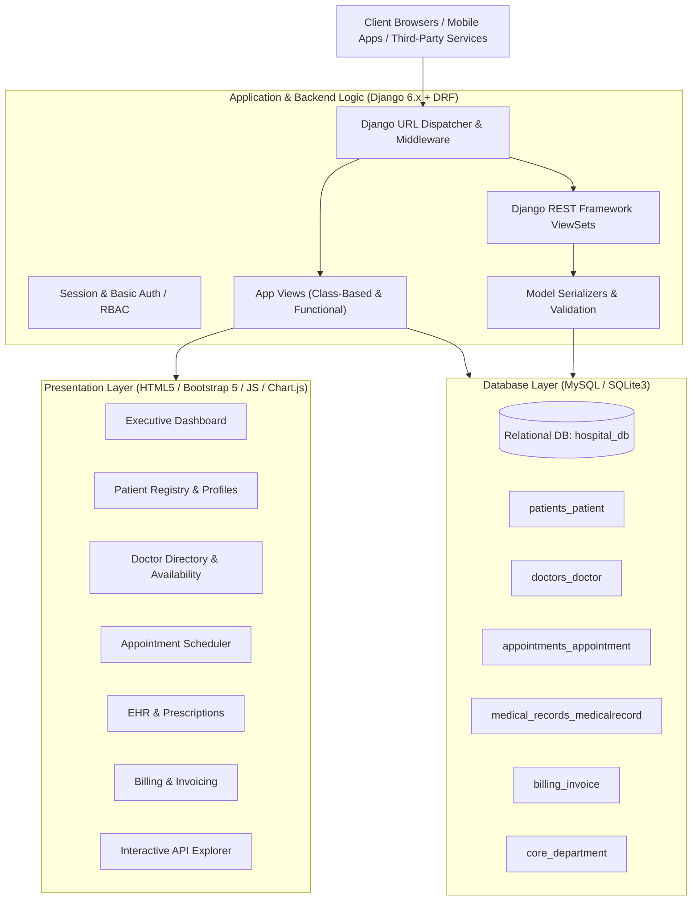
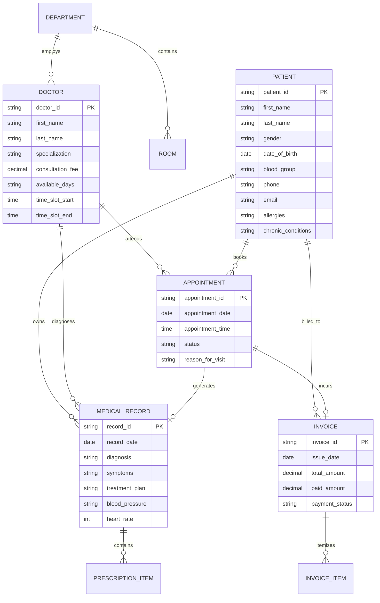

# Hospital Management System (HMS) 2025
### Python | Django | MySQL | REST APIs | Responsive Frontend

[](https://www.python.org/)
[](https://www.djangoproject.com/)
[](https://www.django-rest-framework.org/)
[](https://www.mysql.com/)
[](LICENSE)

---

## 📌 Project Overview
A production-grade, full-stack **Hospital Management System (HMS)** designed to streamline clinical workflows, patient record management, doctor consultations, appointment scheduling, electronic health records (EHR), and patient billing.

### 🌟 Key Highlights & Engineering Achievements
- **Full-Stack Clinical Workflows**: Built a comprehensive web application to manage patient lifecycles, electronic medical records (EMR), doctor schedules, and appointment scheduling.
- **Robust Python & Django Backend**: Engineered backend logic covering core hospital workflows, appointment slot collision detection, multi-model form handling, and strict data validation.
- **Relational Database Design (MySQL)**: Architected a normalized relational database schema with foreign key constraints, indexes, cascade policies, and complete CRUD operations for high-integrity patient data storage and retrieval.
- **RESTful API Engine**: Built standard REST APIs with Django REST Framework (DRF) featuring serializers, viewsets, query filtering, pagination, analytics endpoints, and an interactive live testing console.
- **Modern Responsive Frontend**: Developed an intuitive, accessible dashboard using HTML5, modern CSS3, Bootstrap 5.3, Bootstrap Icons, Chart.js visualizations, and JavaScript for seamless operational efficiency across desktop and mobile devices.
- **Enterprise-Ready Version Control**: Fully version-controlled with Git and configured for immediate deployment to GitHub.

---

## 🏗️ System Architecture



---

## 🗄️ Database Schema & Relationships



---

## ⚡ Core Features

### 1. Executive Analytics Dashboard
- Live KPIs: Total Patients, Today's Consultations, Active Doctors, Bed Occupancy, and Collected Revenue.
- Dynamic charts powered by **Chart.js** displaying doctor allocation by clinical department.
- Fast status tracker for today's appointment lineup with one-click consultation workflows.

### 2. Patient Management (CRUD)
- Unique auto-incrementing ID pattern (`PAT-YYMM-XXXX`).
- Demographic recording, blood grouping, contact information, and emergency guardian contacts.
- Complete clinical history tracking: known drug/food allergies, chronic conditions, and previous surgeries.
- Patient 360° overview tabulating past visits, prescriptions, and billing statements.

### 3. Doctor & Staff Directory
- Physician profiles categorized by clinical department (Cardiology, Neurology, Pediatrics, Orthopedics, General Medicine, Emergency).
- Track practice experience, room/office assignment, consultation fees, and weekly schedule hours.
- Automatic slot validation ensuring zero double-booking for any doctor at a specified time slot.

### 4. Appointment Scheduling System
- Online booking with doctor availability checks.
- Lifecycle tracking: `Scheduled` ➔ `In Progress` ➔ `Completed` ➔ `Cancelled` / `No Show`.
- Quick status change transitions and direct escalation into medical examination or invoicing.

### 5. Medical Records & Electronic Prescriptions
- Clinical examination documentation including vitals: Blood Pressure, Heart Rate, Temperature, and Weight.
- Itemized medication prescriptions (dosage, frequency, duration, and patient instructions).
- Exportable / printable clinical summaries.

### 6. Billing & Invoicing Engine
- Automated invoice calculation: line items, subtotals, configurable taxes, discounts, and payments.
- Real-time balance due computation and payment method tracking (Cash, Credit Card, Insurance, Wire).
- Clean, printable invoice template formatted for patient receipts and insurance claims.

---

## 🔌 RESTful API Reference

All endpoints return JSON and conform to standard REST conventions:

| Method | Endpoint | Description |
|---|---|---|
| `GET`, `POST` | `/api/patients/` | List (with pagination and search) or register patients |
| `GET`, `PUT`, `DELETE` | `/api/patients/<id>/` | Retrieve, update, or remove a patient profile |
| `GET`, `POST` | `/api/doctors/` | List or register physicians |
| `GET` | `/api/doctors/available/` | Filter physicians currently active and available |
| `GET`, `POST` | `/api/appointments/` | Retrieve or schedule an appointment |
| `GET` | `/api/appointments/today/` | Fetch all appointments scheduled for the current day |
| `GET`, `POST` | `/api/medical-records/` | Manage clinical records and prescriptions |
| `GET`, `POST` | `/api/invoices/` | Manage billing statements and line items |
| `GET` | `/api/departments/` | Department listing and doctor counts |
| `GET` | `/api/analytics/summary/` | Aggregated JSON statistics for external dashboards |
| `GET` | `/api/docs/` | Interactive API documentation with live test runner |

---

## 🚀 Quickstart & Setup Guide

### 1. Prerequisites
- Python 3.10+ (Tested up to Python 3.14)
- Git
- MySQL Server (optional; project includes seamless fallback to SQLite3 for zero-setup execution)

### 2. Clone the Repository
```bash
git clone git@github.com:harshtn/Hospital-Management-System.git
cd Hospital-Management-System
```

### 3. Create & Activate Virtual Environment
```bash
# Windows
python -m venv venv
venv\Scripts\activate

# Linux / macOS
python3 -m venv venv
source venv/bin/activate
```

### 4. Install Dependencies
```bash
pip install -r requirements.txt
```

### 5. Database Configuration
The application supports **MySQL** out of the box via `PyMySQL` and also runs out-of-the-box with **SQLite3**:

#### Option A: Running with SQLite3 (Instant Setup - Default)
No extra configuration needed! SQLite is configured as the default database fallback.

#### Option B: Running with MySQL
1. Create a database in MySQL:
   ```sql
   CREATE DATABASE hospital_db CHARACTER SET utf8mb4 COLLATE utf8mb4_unicode_ci;
   ```
2. Copy `.env.example` to `.env` and set `USE_MYSQL=True`:
   ```ini
   USE_MYSQL=True
   DB_NAME=hospital_db
   DB_USER=root
   DB_PASSWORD=your_password
   DB_HOST=127.0.0.1
   DB_PORT=3306
   ```
   *(Alternatively, run the provided raw SQL script `schema_mysql.sql` directly into MySQL Workbench or phpMyAdmin).*

### 6. Apply Migrations & Seed Sample Data
```bash
python manage.py migrate
python manage.py seed_data
```

### 7. Run the Development Server
```bash
python manage.py runserver
```
Visit **http://127.0.0.1:8000/** in your web browser.

---

## 🔐 Default Credentials
| Role | Username | Password |
|---|---|---|
| **System Administrator** | `admin` | `admin123` |
| **Django Admin Panel** | Access at `http://127.0.0.1:8000/admin/` |

---

## 📂 Project Directory Structure

```text
Hospital-Management-System/
├── manage.py                     # Django CLI utility
├── requirements.txt              # Production Python package requirements
├── schema_mysql.sql              # Raw SQL relational schema definition
├── .env.example                  # Environment configuration template
├── .gitignore                    # Git ignore specifications
├── README.md                     # Comprehensive documentation
│
├── hospital_management/          # Project settings & configuration
│   ├── settings.py               # Database, DRF, middleware & app config
│   ├── urls.py                   # Root URL routing
│   ├── wsgi.py                   # WSGI deployment entry point
│   └── asgi.py                   # ASGI deployment entry point
│
├── core/                         # Dashboard, Department, Room, Auth
│   ├── models.py                 # Department and Room models
│   ├── views.py                  # Dashboard metrics and auth controllers
│   ├── urls.py                   # Core URL routes
│   └── management/commands/
│       └── seed_data.py          # Realistic hospital database seeder
│
├── patients/                     # Patient records CRUD
│   ├── models.py                 # Patient model and demographic fields
│   ├── forms.py                  # Patient validation forms
│   ├── views.py                  # CRUD views with search & filtering
│   └── urls.py
│
├── doctors/                      # Doctor & staff directory
│   ├── models.py                 # Doctor model, specialization & slots
│   ├── forms.py                  # Doctor forms
│   ├── views.py                  # Doctor views & search
│   └── urls.py
│
├── appointments/                 # Appointment scheduling & slots
│   ├── models.py                 # Appointment model with conflict check
│   ├── forms.py                  # Slot collision validation logic
│   ├── views.py                  # Booking and status management
│   └── urls.py
│
├── medical_records/              # Prescriptions & EHR
│   ├── models.py                 # MedicalRecord & PrescriptionItem
│   ├── forms.py                  # Formsets for multi-drug prescriptions
│   ├── views.py                  # EHR views
│   └── urls.py
│
├── billing/                      # Patient invoices & payments
│   ├── models.py                 # Invoice & InvoiceItem
│   ├── forms.py                  # Billing formsets
│   ├── views.py                  # Invoice generation & printable receipts
│   └── urls.py
│
├── api/                          # Django REST Framework API engine
│   ├── serializers.py            # DRF serializers with nested representations
│   ├── views.py                  # ModelViewSets and analytics endpoints
│   └── urls.py                   # API router and interactive documentation
│
├── templates/                    # Responsive HTML5 UI templates
│   ├── base.html                 # Main layout with sidebar and topnav
│   ├── dashboard.html            # Analytics and operational dashboard
│   ├── patients/                 # Patient list, detail, forms, delete
│   ├── doctors/                  # Doctor directory, detail, forms
│   ├── appointments/             # Scheduler, detail, booking forms
│   ├── medical_records/          # Clinical records, detail, forms
│   ├── billing/                  # Invoice listings, printable view, forms
│   ├── api/docs.html             # Interactive API documentation & test runner
│   └── accounts/                 # Staff login and register pages
│
└── static/
    ├── css/custom.css            # Medical UI styling & layout
    └── js/app.js                 # Dynamic UI helpers
```

---

## 🤝 Contributing
Contributions, issues, and feature requests are welcome!
Feel free to check [issues page](https://github.com/harshtn/Hospital-Management-System/issues).

---

## 📄 License
This project is licensed under the MIT License - see the LICENSE file for details.
